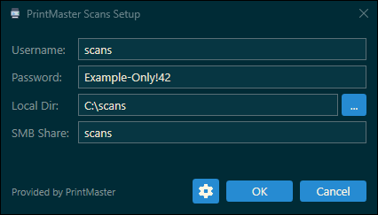
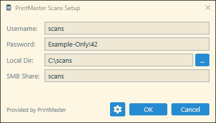
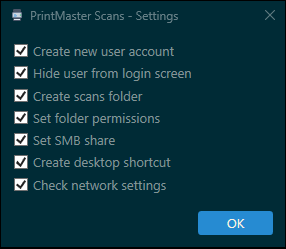
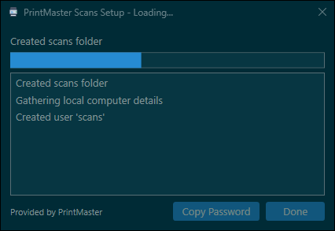
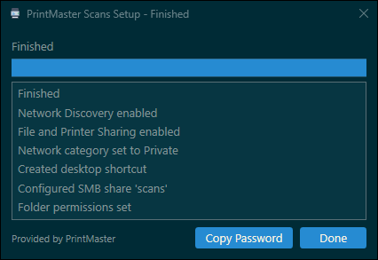

# **Scanning Setup Utility**


A lightweight PowerShell utility that configures a Windows PC for network scanning in one click. Creates a dedicated scan user, shared folder, firewall rules, and desktop shortcut — no manual setup required.

## Quick Start

Paste the following into an **Administrator** PowerShell window:

```powershell
irm https://raw.githubusercontent.com/mstrhakr/scans/main/scans.ps1 | iex
```

### Older Systems (Windows 7 / 8 / Server 2008 R2)

The one-liner above requires TLS 1.2 which older PowerShell versions don't enable by default. Use this two-line variant instead:

```powershell
[Net.ServicePointManager]::SecurityProtocol = [Net.SecurityProtocolType]::Tls12
irm https://raw.githubusercontent.com/mstrhakr/scans/main/scans.ps1 | iex
```

If `Invoke-RestMethod` is not available (PowerShell 2.0), download and run manually:

```powershell
$url = 'https://raw.githubusercontent.com/mstrhakr/scans/main/scans.ps1'
$out = "$env:TEMP\scans.ps1"
(New-Object Net.WebClient).DownloadFile($url, $out)
powershell -ExecutionPolicy Bypass -File $out
```

> **Note:** PowerShell 3.0 or later is required. Windows 7 SP1 ships with PowerShell 2.0 — install [Windows Management Framework 3.0+](https://www.microsoft.com/en-us/download/details.aspx?id=54616) first.

## Requirements

| Requirement | Details |
| --- | --- |
| **OS** | Windows 7 SP1 or later (including Server 2008 R2+) |
| **PowerShell** | 3.0+ |
| **Privileges** | Must be run as Administrator |
| **Network** | Internet access for first run (downloads application icon) |

## What It Does

This script completely sets up the user environment for quick scan-to-SMB:

- Creates or updates a dedicated scan user account (hidden from login screen)
- Creates the scan folder at **C:\scans** (configurable)
- Sets folder permissions for the scan user, current admin, and Everyone
- Shares the folder via SMB as **scans** (configurable)
- Creates a desktop shortcut to the scan folder
- Sets the network category to Private (non-domain PCs)
- Enables File and Printer Sharing firewall rules
- Enables Network Discovery firewall rules

All settings are configurable through the UI before execution.

## Usage

First choose the inputs — the password is randomly generated with a cryptographically secure generator.



The UI automatically matches your Windows theme (light or dark).



Click the gear icon to enable/disable individual steps.



Wait for the utility to complete all changes.



When finished, copy the password and click Done.



### Password policy errors

Windows can reject a scan-account password that does not meet the effective local or domain Group Policy requirements, even for a local account. A short, lowercase-only password may fail minimum-length or complexity rules.

If Windows reports `InvalidPassword` (or `net user` system error `2245` on older systems), setup displays a password-specific popup and remediation tip. It skips hiding the account, folder permissions, and SMB share configuration when account setup fails, and leaves **Copy Password** disabled so an unapplied password is not presented as usable. Independent steps, such as folder creation and network configuration, can still run.

Run setup again with the generated password or a longer password containing uppercase and lowercase letters, numbers, and symbols, without the username. Generated passwords are not guaranteed to satisfy every policy. If the password is still rejected, ask your administrator for the effective minimum length, complexity, history, and any additional restrictions rather than disabling the policy.

### Other setup errors

Startup failures already stop setup with an error popup. Failed setup steps also show a popup and keep the error and remediation in the progress list. Domain trust failures, access denied, and shares in use have specific guidance; unexpected errors retain their original details with general troubleshooting guidance. Successful and skipped steps do not show error popups. Independent steps can continue after a failed step, and the final window reports **Completed with errors**.

## Development and deployment

The Quick Start URL intentionally follows `main`: merging a change to `main` deploys it to users of the one-liner. A GitHub Release is not involved.

Work on a feature branch and open a pull request. The [CI workflow](.github/workflows/ci.yml) runs syntax checks and mocked Pester tests on Windows using both Windows PowerShell 5.1 and PowerShell 7. Its **Required checks** job passes only when both test jobs succeed, including when using a merge queue. CI also runs after pushes to `main` and can be started manually.

To enforce this deployment gate, protect `main` in **Settings > Branches**:

- Require a pull request before merging. Reviewer approval is optional for a solo-maintained repository.
- Require the **Required checks** status check and require branches to be up to date before merging.
- Apply the rules to administrators as well, and disallow force pushes and branch deletion.

The workflow file alone does not enforce these settings. A required check can be configured before its first run; it remains pending until a pull request containing the workflow runs successfully. Do not push directly to `main` or bypass the required check. For a fixed, reproducible deployment, replace `main` in the Quick Start URL with a reviewed full commit SHA.

### Running tests locally

Install the pinned development dependency once (it is not needed by users running the utility):

```powershell
Install-Module Pester -RequiredVersion 4.10.1 -Scope CurrentUser -Force -SkipPublisherCheck
```

From the repository root, run either runtime:

```powershell
powershell.exe -NoProfile -STA -File .\tests\Invoke-Tests.ps1
pwsh.exe -NoProfile -STA -File .\tests\Invoke-Tests.ps1
```

The [test runner](tests/Invoke-Tests.ps1) fails on syntax errors, failing tests, or an empty test run. The [regression suite](tests/Scans.Tests.ps1) extracts function definitions without running the utility's elevation or setup code. Account, registry, filesystem, SMB, firewall, clipboard-related setup gating, and COM changes are mocked; WPF windows are loaded but never displayed. Tests cover password failures, error-popup routing, account visibility, folder setup, shares, network configuration, shortcuts, generated password shape, and setup options. The generator tests do not claim that every generated password satisfies policy.

These checks do not replace a manual test of the real GUI and machine configuration on a disposable Windows VM. CI uses a current Windows runner; legacy command paths are mocked, not tested on Windows 7 or PowerShell 3.0.

## Features

- **Solarized theming** — auto-detects Windows light/dark mode, defaults to dark
- **Legacy OS support** — falls back to `net user`, `net share`, `netsh`, and `Get-WmiObject` on Windows 7/8
- **Error remediation** — shared error popups and inline tips for common failures (password policy, trust relationship, access denied, share in use), plus dependent-step safeguards
- **Single file** — no dependencies, no installation, runs directly from GitHub
