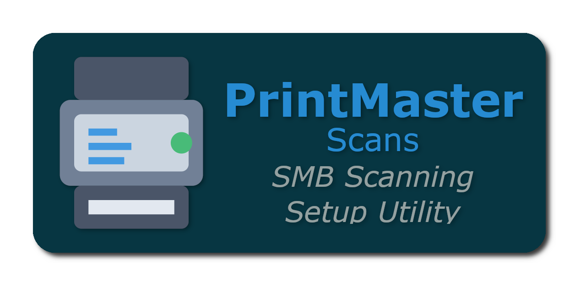

[](https://github.com/Printmaster-Org/scans/releases/latest)
[](https://github.com/Printmaster-Org/scans/actions/workflows/ci.yml)
[](https://github.com/Printmaster-Org/scans/releases)
[](https://docs.printmaster.work/guides/scans/)


A lightweight PowerShell utility that configures a Windows PC for network scanning in one click. Creates a dedicated scan user, shared folder, firewall rules, and desktop shortcut — no manual setup required.

Provided by [PrintMaster](https://printmaster.work/). This is a standalone utility; no PrintMaster Agent or Server is required.

**[Get started](https://scans.printmaster.work/)** · **[Setup and troubleshooting guide](https://docs.printmaster.work/guides/scans/)**

## Quick Start

Paste the following into an **Administrator** PowerShell window:

```powershell
irm https://scans.printmaster.work/scans.ps1 | iex
```

### Stable releases and existing commands

The utility is maintained at **printmaster-org/scans**. The root script and the website use one shared loader implementation. The organization raw URL is also supported:

```powershell
irm https://raw.githubusercontent.com/printmaster-org/scans/main/scans.ps1 | iex
```

The new loader selects the promoted stable release from the site's manifest, downloads its version-specific GitHub asset, checks SHA-256, and only then executes it. A version can be selected explicitly:

```powershell
& ([scriptblock]::Create((irm https://scans.printmaster.work/scans.ps1))) -Version 'v2.1.0'
```

Pinned commands still require the loader and manifest to be available online. The old `mstrhakr/scans` raw URL relies on GitHub's repository-transfer redirect and now also runs the loader, not development utility code. If the site or manifest is unavailable, setup stops rather than falling back to `main`.

See the [transfer and release guide](docs/DEPLOYMENT.md) for rollout order, DNS, publishing, and cutover verification.

## Requirements

| Requirement | Details |
| --- | --- |
| **OS** | Windows 11 primary; Windows 10 22H2 best-effort compatibility |
| **PowerShell** | Windows PowerShell 5.1 or PowerShell 7 |
| **Privileges** | Must be run as Administrator |
| **Network** | Internet access to the release site and GitHub for the loader |

Windows 7/8/8.1 and Windows Server are not validated support targets. Windows 10 compatibility is not a claim of continued Microsoft support. Legacy command fallbacks remain for now; removing them is a separate change.

## What It Does

This script completely sets up the user environment for quick scan-to-SMB:

- Creates or updates a dedicated scan user account (hidden from login screen)
- Creates the scan folder at **C:\scans** (configurable)
- Sets folder permissions for the scan user, current admin, and Everyone
- Shares the folder via SMB as **scans** (configurable)
- Creates a desktop shortcut to the scan folder
- Sets the network category to Private (non-domain PCs)
- Enables File and Printer Sharing firewall rules
- Enables Network Discovery firewall rules

All settings are configurable through the UI before execution.

## Usage

First choose the inputs — the password is randomly generated with a cryptographically secure generator. Screenshots use example credentials and simulated progress/completion states rendered from the current app UI; they do not show a real machine setup. Do not reuse the example password.


The UI automatically matches your Windows theme (light or dark).

App windows use the PrintMaster logo and attribution. The scan-folder desktop shortcut keeps its original scan icon. The self-contained utility embeds the window logo as WPF vector artwork matching [site/logo.svg](site/logo.svg), so branding needs no extra download.


Click the gear icon to enable/disable individual steps.


Wait for the utility to complete all changes.


When finished, copy the password and click Done.


### Password policy errors

Windows can reject a scan-account password that does not meet the effective local or domain Group Policy requirements, even for a local account. A short, lowercase-only password may fail minimum-length or complexity rules.

If Windows reports `InvalidPassword` (or `net user` system error `2245` on older systems), setup displays a password-specific popup and remediation tip. It skips hiding the account, folder permissions, and SMB share configuration when account setup fails, and leaves **Copy Password** disabled so an unapplied password is not presented as usable. Independent steps, such as folder creation and network configuration, can still run.

Run setup again with the generated password or a longer password containing uppercase and lowercase letters, numbers, and symbols, without the username. Generated passwords are not guaranteed to satisfy every policy. If the password is still rejected, ask your administrator for the effective minimum length, complexity, history, and any additional restrictions rather than disabling the policy.

### Other setup errors

Startup failures already stop setup with an error popup. Failed setup steps also show a popup and keep the error and remediation in the progress list. Domain trust failures, access denied, and shares in use have specific guidance; unexpected errors retain their original details with general troubleshooting guidance. Successful and skipped steps do not show error popups. Independent steps can continue after a failed step, and the final window reports **Completed with errors**.

## Development and deployment

Both public entrypoints select manually published, versioned GitHub Releases. Merging utility code does not deploy it to users. Merging loader changes does update the raw-main loader; website loader changes require a Pages refresh.

Pushing a stable SemVer tag starts the [Prepare release workflow](.github/workflows/release.yml). It reuses successful main-push CI for that exact commit instead of running tests again, then creates a draft with generated PR-based notes, a pinned command, the utility, metadata, and SHA-256. It waits briefly if main CI is still running and fails if that CI did not pass. Manual dispatch from `main` can retry an existing tag and packages that tag's source, not newer main code. Review/edit the notes, manually test on a disposable Windows VM, then publish the draft in GitHub. User publication triggers the [Pages workflow](.github/workflows/pages.yml), which also reuses existing CI, verifies published assets against their tagged source, and deploys the site plus manifest as generated artifacts. No bot pushes or protection bypasses are needed.

Website source is in [site/](site/); the only loader source is [scans.ps1](scans.ps1). The site builder copies it unchanged into its deployment output. The actual utility is [src/scans.ps1](src/scans.ps1); release packaging selects that file, never the loader. New stable tags must use `vMAJOR.MINOR.PATCH`; historical four-part tags are retained and linked through GitHub Releases, but not exposed through the new checksum-verified channel.

The landing page follows the PrintMaster site's Solarized palette, teal accents, wordmark, and panel styling. Standalone navigation is Scans-focused: its brand links home locally, setup and release links stay on the page, and external Scans resources are explicitly labeled. The footer separates Agent/Server downloads and fleet-monitoring links under "More from PrintMaster." Styles and the logo are local to this repository; navigation works without JavaScript, and the layout supports light/dark preferences, keyboard navigation, and reduced motion. Release rendering and copy buttons use [site/releases.js](site/releases.js).

The main website can frame `https://scans.printmaster.work/?embed=1` at `/scans/`. [site/embed.js](site/embed.js) hides this site's header/footer and locks the dark palette only after a handshake from the immediate parent at `https://printmaster.work`. Without that handshake (including direct visits and JavaScript disabled), the full standalone site remains visible. Origin- and source-checked messages report content height and anchor positions to the main site's wrapper. External links open at the top level; setup commands retain their canonical standalone URLs. The main site owns its header/footer and clipboard delegation. Deploy this embed support before the main-site wrapper.

The handshake restricts embed-mode activation, not who can frame the public standalone site. GitHub Pages cannot set a custom HTTP `Content-Security-Policy: frame-ancestors` header; a meta tag cannot enforce it. If the domain later uses a configurable edge/server, set `frame-ancestors 'self' https://printmaster.work` there and avoid `X-Frame-Options: DENY`/`SAMEORIGIN`, which would block the cross-origin main-site frame.

Work on a feature branch and open a pull request. The [CI workflow](.github/workflows/ci.yml) runs syntax checks and mocked Pester tests on Windows using both Windows PowerShell 5.1 and PowerShell 7. Its **Required checks** job passes only when both test jobs succeed, including when using a merge queue. CI also runs after pushes to `main` and can be started manually.

External actions are pinned to full commit SHAs. [Dependabot](.github/dependabot.yml) checks GitHub Actions dependencies weekly and opens update PRs; updates must pass the same required CI.

To enforce this deployment gate, protect `main` in **Settings > Branches**:

- Require a pull request before merging. Reviewer approval is optional for a solo-maintained repository.
- Require the **Required checks** status check and require branches to be up to date before merging.
- Apply the rules to administrators as well, and disallow force pushes and branch deletion.

The workflow file alone does not enforce these settings. A required check can be configured before its first run; it remains pending until a pull request containing the workflow runs successfully. Do not push directly to `main` or bypass the required check.

### Running tests locally

Install the pinned development dependency once (it is not needed by users running the utility):

```powershell
Install-Module Pester -RequiredVersion 4.10.1 -Scope CurrentUser -Force -SkipPublisherCheck
```

From the repository root, run either runtime:

```powershell
powershell.exe -NoProfile -STA -File .\tests\Invoke-Tests.ps1
pwsh.exe -NoProfile -STA -File .\tests\Invoke-Tests.ps1
node --test .\tests\site.test.cjs .\tests\embed.test.cjs
```

The [test runner](tests/Invoke-Tests.ps1) fails on syntax errors, failing tests, or an empty test run. The [regression suite](tests/Scans.Tests.ps1) extracts function definitions without running the utility's elevation or setup code. Account, registry, filesystem, SMB, firewall, clipboard-related setup gating, and COM changes are mocked; WPF windows are loaded but never displayed. Tests cover password failures, error-popup routing, account visibility, folder setup, shares, network configuration, shortcuts, generated password shape, and setup options. The generator tests do not claim that every generated password satisfies policy.

The [release tests](tests/Releases.Tests.ps1) cover loader selection, verification failures, temporary-file cleanup, package integrity, and site generation. Site rendering tests use Node's built-in test runner with no additional dependencies.

These checks do not replace a manual test of the real GUI and machine configuration on a disposable Windows VM. CI uses a current Windows runner; Windows 10 compatibility and legacy command paths are not exercised on an actual Windows 10 runner.

## Features

- **Solarized theming** — auto-detects Windows light/dark mode, defaults to dark
- **Platform support** — Windows 11 primary; Windows 10 22H2 best-effort compatibility
- **Error remediation** — shared error popups and inline tips for common failures (password policy, trust relationship, access denied, share in use), plus dependent-step safeguards
- **Portable utility** — no application installation; release loader verifies downloads before execution
